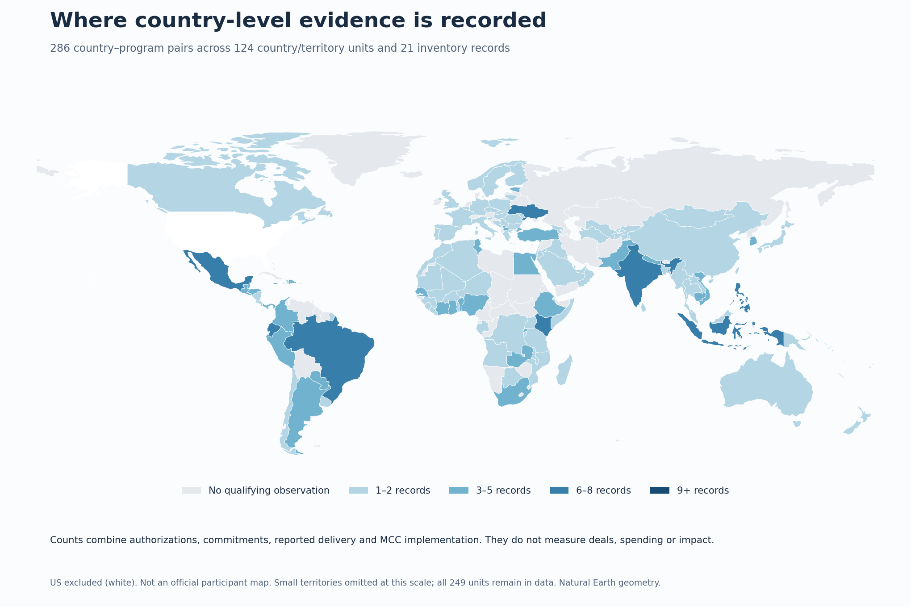
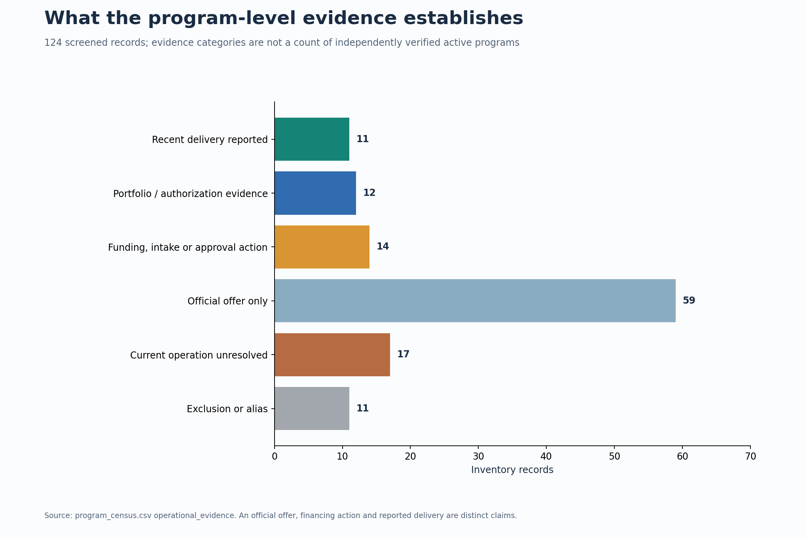
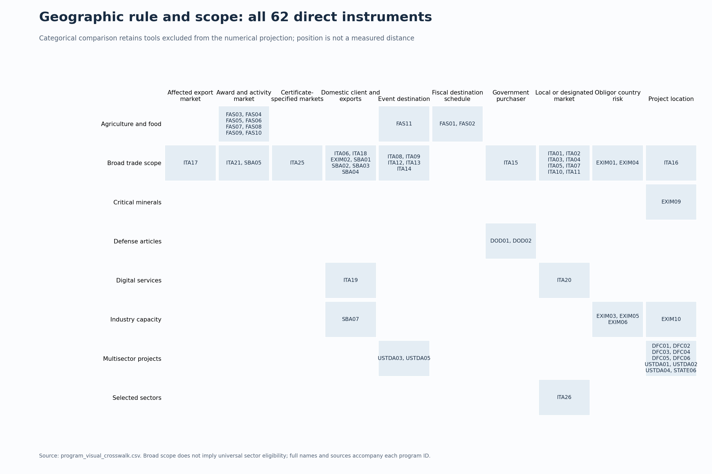
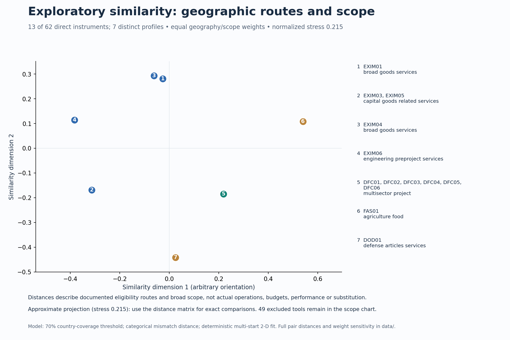

# U.S. Trade Facilitation — Trade over Aid

An informative, evidence-led **brief white paper with abundant visualizations**. Prepared for a senior diplomatic audience; this is a research product, not travel advice.

## Read the current edition — v0.15

- [Three-page white paper (PDF)](project/deliverables/US_Trade_Facilitation_Informative_Paper_v0_15.pdf) · [editable Word](project/deliverables/US_Trade_Facilitation_Informative_Paper_v0_15.docx)
- [Fourteen-page visual atlas](project/deliverables/Trade_Program_Evidence_Atlas_v0_15.pdf)
- [Research status and rigor](project/deliverables/Research_Status_and_Rigor_v0_15.txt) · [Methods and census boundary](project/deliverables/Methods_and_Census_Boundary_v0_15.txt)
- [Current data](project/data) · [Charts (PNG and SVG)](project/figures/v15) · [Scripts](project/scripts) · [Validation](project/validation)

The current research inventory contains **124 records**, including **62 direct instruments**. The country matrices cover **110 records and 249 country/territory units**. There are **286 qualifying country–program pairs across 21 records and 124 country units**. These are documented observations, not a census of all actual activity or evidence that every listed program is currently active.

The latest update adds ten observations and five qualifying pairs. It expands FAS mission delivery, USTDA forum activity and final-report metadata, and historical Commerce matchmaking evidence. It does not verify new 2026 Commerce Gold Key/IPS delivery or resolve legacy award continuation.

## Visual overview









The similarity view covers only 13 comparable tools, not the entire inventory; its distortion and exclusions are documented in the atlas. Unknown evidence must not be read as no activity. Delivery, approvals, portfolio observations, schedules, historical activity, eligibility and office presence remain distinct.

## Full materials and reproducibility

This repository is the canonical project home. The `project/` directory provides current data, scripts, deliverables and charts for browsing. The complete retained research tree—**3,538 files**, including prior versions and source snapshots—is preserved in the [v0.15 multipart archive](archives/v0.15). Parts are standard gzip/tar bytes split to fit practical transfer limits, not Git LFS pointers.

After cloning or downloading the repository, restore and verify every archived file:

```sh
python scripts/restore_archive.py --output restored-v0.15
```

The script checks every part, the joined archive and every file against SHA-256 hashes. It restores to `restored-v0.15/project/`; it does not overwrite the browseable project directory. Full rebuilding should use that restored tree, which contains older script dependencies, source files and baselines. See its `START_HERE.txt` and `scripts/dependencies.txt`. PDF generation additionally needs the document rendering dependencies used in the retained scripts; this is not a hermetic build.

The [related agency-verification package](related/agency-verification-v0.4.zip) is retained separately. Its outreach drafts and distinct record scheme are not silently merged into this census; no requests were sent as part of this update.

See [PROJECT_BRIEF.md](PROJECT_BRIEF.md) for the editorial goal and [AGENTS.md](AGENTS.md) for continuation rules. This is a dated evidence synthesis as of 15 October 2026, not real-time certification of program status.
